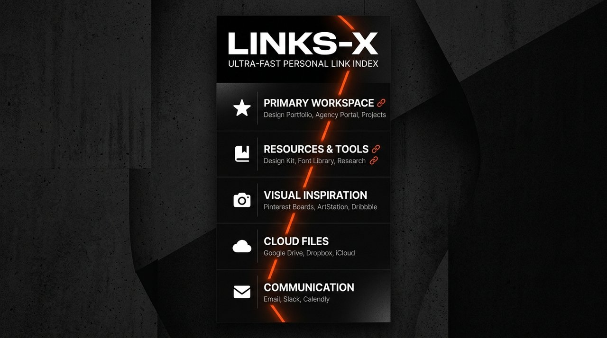

# Links-X // High-Contrast Tactile Link Directory

<p align="center">
  
</p>

> **High-contrast, hyper-fast personal link directory and tactile bio hub engineered with zero dependencies.**

---

## Overview

**Links-X** is an opinionated, high-contrast personal link index crafted for maximum legibility and speed. Stripping away modern web bloat, it delivers a direct, tactile list interface with rich category grouping, instant keyboard filtering, and mobile-optimized touch ergonomics.

---

## Key Features

- **High-Contrast Brutalist Aesthetic**: Obsidian black canvas, crisp typography, and electric neon accents.
- **Zero-Dependency Core**: Pure HTML, CSS custom properties, and native ES6 JavaScript.
- **Tactile Touch Targets**: Built with generous 52px touch areas optimized for one-handed mobile browsing.
- **Instant Client-Side Filtering**: Real-time link search without network latency.
- **Lightweight Payload**: Under 25 KB total compressed weight.

---

## Deployment & Setup

1. Clone the repository:
   ```bash
   git clone https://github.com/emaf205/EmaF205-LinksX.git
   ```
2. Configure your links in `index.php` or `index.html`.
3. Deploy directly to any web server or static host.

---

## License & Attribution

Designed and built by **Emanuele BDC (EmaF205)**.  
Released under the [MIT License](LICENSE).
